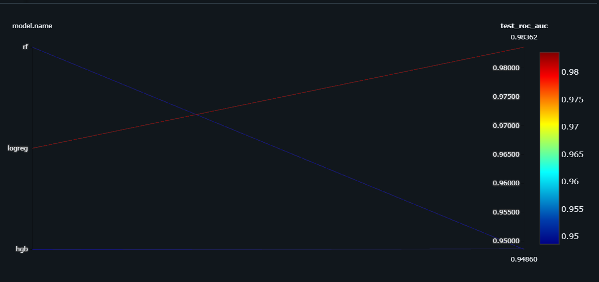
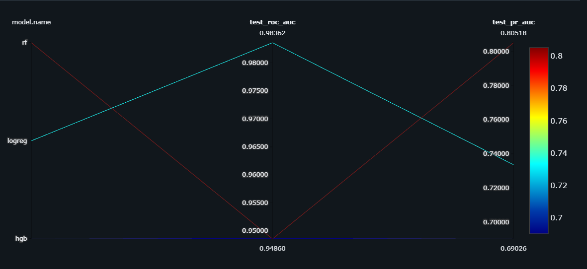
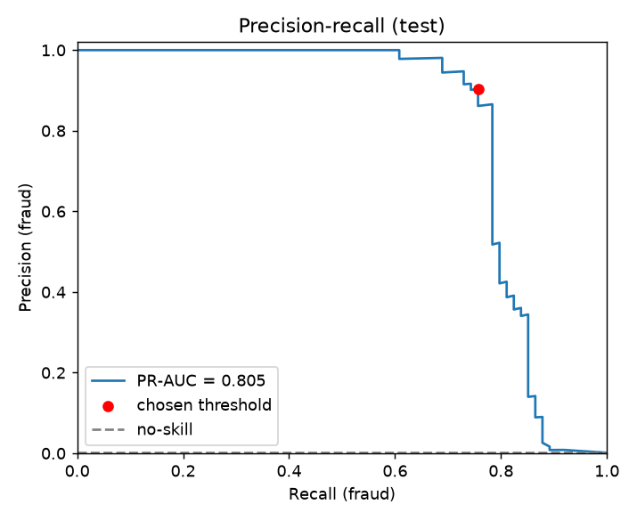
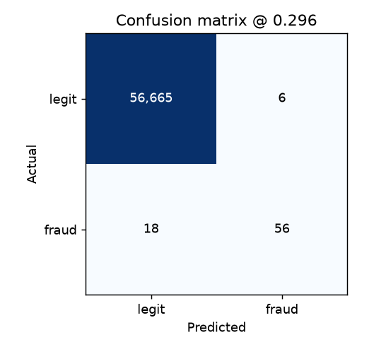
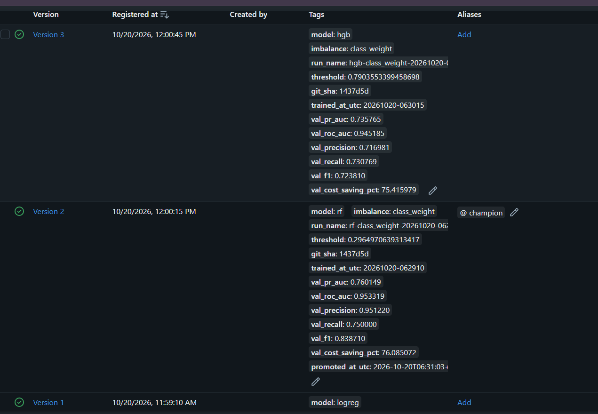
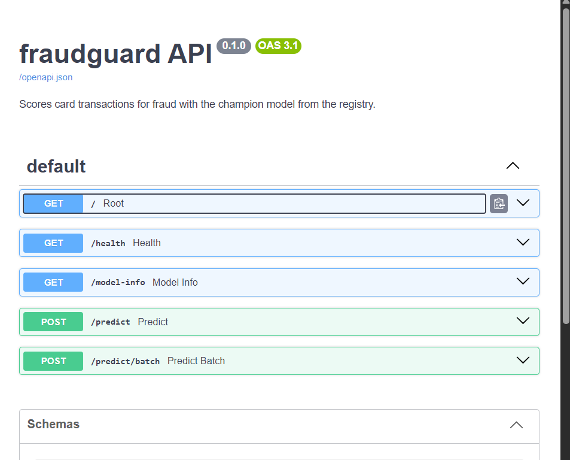
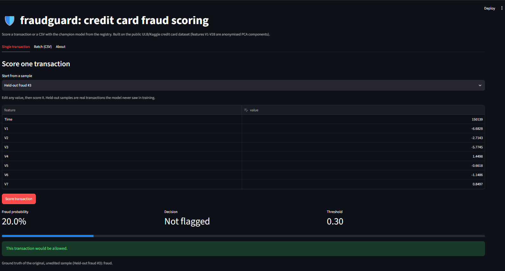
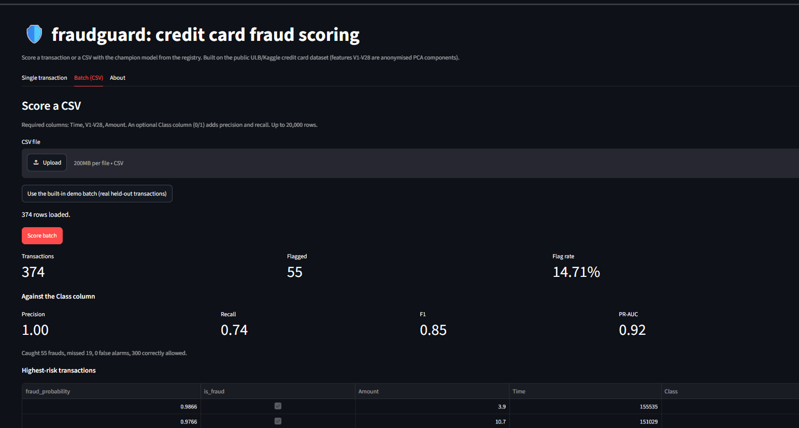

# fraudguard: credit card fraud detection, built like a product

A fraud-detection pipeline with correct metrics for imbalanced data, a cost-based decision threshold,
MLflow experiment tracking and model registry, a FastAPI scoring service and a Streamlit UI.

> Status: **work in progress.** Each roadmap step lands as its own pull request (see the commit history).

This project started as two exploratory notebooks (kept in [notebooks/legacy](notebooks/legacy)). A review of
what was wrong with them, and what changed, is in [docs/findings.md](docs/findings.md).

## Why not just `model.fit()` and report accuracy?

Only 0.17 % of the transactions are fraud. So this project:

- evaluates with **PR-AUC and fraud-class precision/recall**, never accuracy or weighted F1;
- splits **by time** (train on the past, test on the future), the way a production model is used;
- picks the decision threshold on a **validation** window from explicit costs: a missed fraud costs its
  amount, a false alarm costs a fixed review cost (both configurable in `configs/train.yaml`);
- selects the champion model on **validation** PR-AUC, so the test set is only ever used for reporting;
- keeps all preprocessing **inside the sklearn Pipeline**, so serving never re-implements it.

## Results

Time-based hold-out: train on the earliest transactions, tune the threshold on the next window, test on the
most recent 20 % (56,745 transactions, **74 frauds**). A missed fraud costs its amount, a false alarm costs 5
(an assumption, see the config).

| Model | Validation PR-AUC (used to pick) | Test PR-AUC | Fraud precision | Fraud recall | F1 | Caught / missed | False alarms | Cost saving* |
|---|---|---|---|---|---|---|---|---|
| Logistic regression | 0.731 | 0.734 | 0.942 | 0.662 | 0.778 | 49 / 25 | 3 | 60.8 % |
| **Random forest (champion)** | **0.760** | **0.805** | 0.903 | 0.757 | 0.824 | 56 / 18 | 6 | 65.5 % |
| Gradient boosting (untuned) | 0.736 | 0.690 | 0.739 | 0.689 | 0.713 | 51 / 23 | 18 | 44.7 % |

\*Cost relative to having no model, under the assumed costs in `configs/train.yaml`.

With only 74 frauds in the test window, a difference of a few transactions is within noise. Gradient boosting
runs on near-default parameters; tuning is future work.




Best model (random forest) on the test window:

 

## Model registry

Every trained model is registered as a version of `fraud-detector` with its threshold and validation
metrics as tags. `python -m fraudguard.registry promote` gives the best version the `champion` alias,
ranked by **validation PR-AUC** (never the test set), and only replaces an existing champion if the
challenger is better.



## API

```bash
python -m fraudguard.registry export --out artifacts/champion   # champion -> model.joblib + metadata.json
uvicorn fraudguard.api.main:app --reload                        # http://127.0.0.1:8000/docs
```

| Endpoint | Purpose |
|---|---|
| `POST /predict` | Score one transaction (optional `?threshold=0.5` override) |
| `POST /predict/batch` | Score up to 1,000 transactions |
| `GET /model-info` | Model version, threshold, validation metrics |
| `GET /health` | Liveness; returns 503 with the reason if the model failed to load |

Requests are validated strictly: unknown fields, negative amounts and non-numeric values return 422.
A sample payload is in [docs/sample_transaction.json](docs/sample_transaction.json).



## UI

A Streamlit app scores single transactions (with an approximate per-feature explanation) and CSV batches,
with an adjustable decision threshold. It calls the API when `FRAUD_API_URL` is set; otherwise it loads the
exported champion directly.

```bash
pip install -r requirements-ui.txt
python scripts/make_demo_samples.py            # held-out demo transactions (needs the dataset)
uvicorn fraudguard.api.main:app                # terminal 1
FRAUD_API_URL=http://127.0.0.1:8000 streamlit run app/streamlit_app.py   # terminal 2
```

On Windows PowerShell set the variable first: `$env:FRAUD_API_URL="http://127.0.0.1:8000"`.




## Docker

One command starts the API, the UI and an MLflow server:

```bash
docker compose up --build
```

| Service | URL |
|---|---|
| API (FastAPI docs) | http://localhost:8000/docs |
| UI (Streamlit) | http://localhost:8501 |
| MLflow | http://localhost:5000 |

The API image serves the exported champion from `deploy/champion/`. After promoting a new champion, refresh it with
`python -m fraudguard.registry export --out deploy/champion` and rebuild. The images pin the library versions the
model was trained with, because a pickled scikit-learn model must be loaded by the same version.

To send training runs to the containerised MLflow server instead of the local SQLite file, set
`FRAUD_TRACKING_URI=http://127.0.0.1:5000` before running `python -m fraudguard.train`
(PowerShell: `$env:FRAUD_TRACKING_URI="http://127.0.0.1:5000"`).

## Quickstart

```bash
python -m venv .venv && source .venv/bin/activate      # Windows: .venv\Scripts\Activate.ps1
pip install -r requirements-dev.txt && pip install -e .

python scripts/download_data.py                        # real data via Kaggle CLI (needs ~/.kaggle/kaggle.json)
# or: python scripts/download_data.py --synthetic      # instant demo data, never report results from it

python -m fraudguard.train --config configs/train.yaml --models logreg,rf,hgb
python -m fraudguard.registry promote
mlflow ui --backend-store-uri sqlite:///mlflow.db      # http://127.0.0.1:5000
pytest
```

The `Makefile` wraps these commands for Linux and macOS.

## Project layout

```
app/                      Streamlit UI and demo data (held-out real transactions)
deploy/champion/          the exported champion model the API image serves
docker/                   pinned runtime requirements and the container health probe
Dockerfile.api, Dockerfile.ui, Dockerfile.mlflow, docker-compose.yml
configs/train.yaml        every knob: split, features, imbalance handling, model, costs, tracking, registry
docs/                     findings on the original notebooks, screenshots, sample payload
notebooks/legacy/         the original exploratory notebooks, kept for history
scripts/                  data download, demo-sample creation
src/fraudguard/
  data.py                 schema validation, de-duplication, time / stratified split
  features.py             preprocessing (log-amount, hour-of-day, scaling) as a ColumnTransformer
  models.py               logreg, random forest, hist-gradient-boosting, lightgbm (+ optional SMOTE)
  metrics.py              fraud-class metrics, cost-based threshold selection
  tracking.py             MLflow wrapper (a no-op tracker is used in tests)
  registry.py             register, promote, export the champion
  serving.py              model loading and scoring, framework-free
  api/                    FastAPI app and request/response schemas
  ui_core.py              UI backends, batch scoring, explanations
  train.py                training CLI
tests/                    metrics are checked against a brute-force reference; API tested end to end
```

## Roadmap

- [x] **1. Project structure**: package, config, data script, tests
- [x] **2. Correct evaluation**: time split, PR-AUC, cost-based threshold, three model families
- [x] **3. MLflow**: model registry with a `champion` alias, promotion rule
- [x] **4. FastAPI service**: `/predict`, `/predict/batch`, `/health`, `/model-info`
- [x] **5. Frontend**: Streamlit UI with single and batch scoring
- [x] **6. Docker + docker-compose**: API, UI and MLflow
- [ ] **7. CI/CD**: GitHub Actions (lint, tests, image build, deploy)
- [ ] **8. Monitoring**: drift report and prediction logging
- [ ] **9. Hosting**: free-tier deployment and a live demo link

## Data and credits

Dataset: *Credit Card Fraud Detection*, Machine Learning Group, ULB, distributed on Kaggle
(<https://www.kaggle.com/datasets/mlg-ulb/creditcardfraud>). Features `V1`-`V28` are PCA components of
two days of European card transactions. The small demo excerpt in `app/` comes from the held-out test window.
The cost values in the config are illustrative assumptions, not real bank figures.
